# 🚗 KANAB Motors PLC — Executive & Technical Presentation Guide
## Comprehensive Delivery Demonstration: KMSICAMS-2 & KMSICAMS-17
### *Commercial Sales Pipeline, Governance Controls & Double-Entry Financial Engine*

> **Document Type:** Live Demonstration Script & Step-by-Step Presenter Manual  
> **Presenter:** System Lead / Solution Architect  
> **Target Audience:** Executive Management, Head of Sales, Chief Financial Officer (CFO), Technical Stakeholders  
> **Production Live URL:** [https://kanab.skylinkict.com](https://kanab.skylinkict.com)  
> **Jira Scope:** Unified Delivery of **`KMSICAMS-2`** (Sales Pipeline & Settlement) & **`KMSICAMS-17`** (Governance & Ledger Core)  
> **Deployment Status:** 100% Implemented, Migrated & Verified Live on Production  

---

## 📌 Executive Summary

This presentation demonstrates the unified commercial sales, governance, and financial settlement infrastructure delivered for **KANAB Motors PLC**. 

The system transitions KANAB Motors from disconnected spreadsheets into a fully audited, real-time enterprise ERP.

### Key Milestones Achieved:
1. **End-to-End Sales Pipeline:** Inception $\longrightarrow$ Technical Inspection $\longrightarrow$ Financing Structure $\longrightarrow$ Manager Approval $\longrightarrow$ 1-Click Booking.
2. **Four Critical Governance Controls (KMSICAMS-17 Red-Line Items):**
   - **`[KMSICAMS-17 · Stories E16–E18]` Pre-Advance Slip Auto-Generation:** 3-day validity window (`⏳ 3d left`), 100% price lock, and print isolation.
   - **`[KMSICAMS-17 · Stories B3–B4]` 100% Full Advance Mandate:** Mandates 100% price commitment upon booking conversion, eliminating unbacked vehicle reservations.
   - **`[KMSICAMS-17 · Story P14]` CEO/CSO Installment Approval Gate:** Hard technical lock on split payment vouchers; cashier confirmation is physically disabled until executive approval.
   - **`[KMSICAMS-17 · Stories X9–X10]` Two-Sided Atomic Credit Transfer:** Real-time cross-customer credit reallocation with zero financial drift and atomic rollback safety.
3. **Double-Entry Financial Sub-Ledger (`[KMSICAMS-2 & 17 · Stories L1–L10]`):**
   - Concurrency-safe running balance with PostgreSQL pessimistic row-level locking (`SELECT ... FOR UPDATE`).
   - Monotonic audit trail guaranteeing zero double-spend and zero balance drift.

---

## 🔄 End-to-End System Flow Architecture

```mermaid
flowchart TD
    subgraph STAGE1["Stage 1: Pre-Sales & Commercial Pipeline [KMSICAMS-2 / KMSICAMS-17]"]
        A["Customer Enquiry Entry"] --> B{"Commercial Structure"}
        B -->|"Lead Broker"| B1["Commission Agent Tracking<br/>[KMSICAMS-17 · Story 1]<br/>(Dynamic ETB Auto-Calc)"]
        B -->|"Physical Check"| B2["Vehicle Pre-Inspection<br/>[KMSICAMS-17 · Story 2]<br/>(120-min Live Timer & VIN)"]
        B -->|"Financing"| B3["Commercial Bank / MFI<br/>[KMSICAMS-17 · Story 3]<br/>(70% Loan vs 30% Equity)"]
    end

    subgraph STAGE2["Stage 2: Governance & Price Commitment [KMSICAMS-17]"]
        B1 & B2 & B3 --> C["Sales Manager Approval<br/>[KMSICAMS-2 · Story E9]"]
        C --> D["Auto-Generated Pre-Advance Slip<br/>[KMSICAMS-17 · Stories E16-E18]<br/>(3-Day Validity Countdown · 100% Price Lock)"]
        D --> E["Convert to Booking<br/>[KMSICAMS-17 · Stories B3-B4]<br/>(100% Advance Deposit Mandate)"]
    end

    subgraph STAGE3["Stage 3: Treasury & Bank Receipt Verification (BRV) [KMSICAMS-17]"]
        E --> F["Deposit Intake (BRV-YYYY-XXXXX)<br/>[KMSICAMS-2 · Stories P1-P3]"]
        F --> G{"Payment Type"}
        G -->|"Standard Full Payment"| H["Cashier Direct Confirmation<br/>[KMSICAMS-2 · Story P4]"]
        G -->|"Split / Installment"| I["CEO / CSO Approval Gate<br/>[KMSICAMS-17 · Story P14]<br/>(Strictly Locked Until Endorsed)"]
        I -->|"Approved by Management"| H
    end

    subgraph STAGE4["Stage 4: Atomic Financial Engine & Sub-Ledger [KMSICAMS-2 & 17]"]
        H --> J["Pessimistic Row Lock (SELECT FOR UPDATE)<br/>[KMSICAMS-17 · Story L2]"]
        J --> K["Post to Customer Ledger Transaction<br/>[KMSICAMS-17 · Stories L1, L8]<br/>(Credit Amount · Deterministic Running Balance)"]
        K --> L["Synchronize Customer Account Summary<br/>[KMSICAMS-17 · Story L4]<br/>(Total Deposits · Available Credit · Refundable)"]
    end

    subgraph STAGE5["Stage 5: Excess Routing, Transfer & Settlement [KMSICAMS-17]"]
        L --> M{"Balance Allocation"}
        M -->|"Excess Over Booking"| N["Excess Fund Re-Routing<br/>[KMSICAMS-2 · Stories X1-X8]<br/>(Store Credit vs Refundable)"]
        N -->|"Cross-Customer Need"| O["Two-Sided Atomic Credit Transfer<br/>[KMSICAMS-17 · Stories X9-X10]<br/>(-ETB Source / +ETB Destination)"]
        N -->|"Payout Requested"| P["Customer Refund Engine<br/>[KMSICAMS-2 & 17 · Stories R1-R12]<br/>(4-Tier Audit Review & Settlement)"]
    end

    style STAGE1 fill:#0f172a,stroke:#38bdf8,stroke-width:2px,color:#fff
    style STAGE2 fill:#0f172a,stroke:#a855f7,stroke-width:2px,color:#fff
    style STAGE3 fill:#0f172a,stroke:#f59e0b,stroke-width:2px,color:#fff
    style STAGE4 fill:#0f172a,stroke:#10b981,stroke-width:2px,color:#fff
    style STAGE5 fill:#0f172a,stroke:#06b6d4,stroke-width:2px,color:#fff
```

---

## 🎭 Step-by-Step Live Presentation Guide

---

### 📍 STAGE 1: Pre-Sales Pipeline, Commission & Technical Inspection

> 🏷️ **Jira Coverage:** `[KMSICAMS-2 · Stories E1–E15]` & `[KMSICAMS-17 · Stories 1, 2, 3]`  
> 🎯 **Goal:** Create an enquiry with broker commission, bank financing, and vehicle inspection timer.

#### 📊 Data to Use in Stage 1:
- **Customer:** `CUST-000008 — government1`
- **Vehicle Item:** `Bajaj kanab-0032 (NEW) — BP-002`
- **Unit Price:** `150,000.00` | **Quantity:** `1` | **VAT (15%):** `22,500.00` | **Total:** `172,500.00`
- **Lead Source:** `COMMISSION AGENT`
- **Commission Broker:** Name: `Dawit Kebede` | Phone: `+251 911 334455` | Rate: `3.00%` (Commission = `ETB 5,175.00`)
- **Financing:** Structure: `Bank Financing (Commercial Bank)` | Bank: `Commercial Bank of Ethiopia` | %: `70%`
- **Inspection Data:** VIN: `WBA33AY08PFS99120` | Engine: `ENG-772910-ET` | Inspector: `Senior Technical Inspector` | Timer: `120 min`

---

#### 🗣️ What to Say (Speaker Script):
> *"Good morning, executive management and colleagues. We begin in the Commercial Sales Pipeline. In vehicle trading, pre-sales transactions are multifaceted: they involve broker commissions, pre-purchase technical checks, and commercial bank credit commitments. Rather than managing these in disconnected spreadsheets, our system unifies all three directly into the sales enquiry workflow."*

---

#### 🎬 Live Demo: What to Do Step-by-Step:

##### Part A: Create the Sales Enquiry with Broker Commission & Bank Financing
1. 👉 **Do this:** In the left sidebar under **Financial Settlement**, click this menu item: **`Sales Enquiries & Quotes`** `[KMSICAMS-2 · Story E10]`.
2. 👉 **Do this:** At the top right of the page, click this button: **`+ New Sales Enquiry`** `[KMSICAMS-2 · Story E14]`.
3. 👉 **Do this:** In the form dropdown **`Customer *`**, select: **`CUST-000008 — government1`** `[KMSICAMS-2 · Story E2]`.
4. 👉 **Do this:** In the form dropdown **`Vehicle Model *`**, select: **`Bajaj kanab-0032 (NEW) — BP-002`** `[KMSICAMS-2 · Story E3]`.
5. 👉 **Do this:** In the box **`Unit Price (ETB)`**, type: **`150000.00`** and in **`Quantity *`**, type: **`1`** `[KMSICAMS-2 · Story E1]`.
6. 👉 **Do this:** In the dropdown **`Intended Payment Mode *`**, select: **`Bank Deposit Voucher (BRV)`** `[KMSICAMS-2 · Story E6]`.
7. 👉 **Do this:** In the dropdown **`Lead Source`**, select: **`COMMISSION AGENT`** `[KMSICAMS-17 · Story 1]`.
8. 👉 **Do this:** In the purple card *Commission Agent Details*:
   - In the box **`Commission Agent Name *`**, type: **`Dawit Kebede`**
   - In the box **`Agent Contact Phone *`**, type: **`+251 911 334455`**
   - In the box **`Commission Rate % (0.01% - 100%) *`**, type: **`3.00`** `[KMSICAMS-17 · Story 1]`
9. 👉 **Do this:** In the cyan card *Commercial Financing Option*:
   - In the dropdown **`Financing Structure`**, select: **`Bank Financing (Commercial Bank)`**
   - In the box **`Financing % (Default 70%) *`**, keep or type: **`70`**
   - In the box **`Bank Institution Name *`**, type: **`Commercial Bank of Ethiopia`** `[KMSICAMS-17 · Story 3]`
10. 👉 **Do this:** At the bottom right of the modal, click this button: **`Submit Enquiry`** `[KMSICAMS-2 · Stories E8, E9]`.

👀 **Now show the audience:**
- **Show the 15% VAT calculation:** Point out that Subtotal `150,000.00` + VAT `22,500.00` = **`ETB 172,500.00`** `[KMSICAMS-2 · Story E4]`.
- **Show the Broker Commission:** Point to the auto-calculated commission field showing:
  $$\text{ETB } 172,500.00 \times \frac{3.00\%}{100} = \mathbf{\text{ETB } 5,175.00} \quad \text{[KMSICAMS-17 · Story 1]}$$
- **Show the Bank Financing Split:** Point to **Bank Loan (70%)** = **`ETB 120,750.00`** and **Customer Cash Equity (30%)** = **`ETB 51,750.00`** `[KMSICAMS-17 · Story 3]`.

---

##### Part B: Schedule Technical Vehicle Pre-Inspection with Live Timer
11. 👉 **Do this:** In the enquiry table row, click this cyan button: **`Inspect`** `[KMSICAMS-17 · Story 2]`.
12. 👉 **Do this:** In the box **`VIN / Chassis Number`**, type: **`WBA33AY08PFS99120`** `[KMSICAMS-17 · Story 2]`.
13. 👉 **Do this:** In the box **`Engine Number`**, type: **`ENG-772910-ET`** `[KMSICAMS-17 · Story 2]`.
14. 👉 **Do this:** In the box **`Technical Inspector Name`**, type: **`Senior Technical Inspector`** `[KMSICAMS-17 · Story 2]`.
15. 👉 **Do this:** In the box **`Allowed Duration (Default 120 min)`**, ensure it says: **`120`** `[KMSICAMS-17 · Story 2]`.
16. 👉 **Do this:** In the box **`Inspection Pre-Check Notes`**, type: **`Battery health 98%, paint thickness verified, odometer 12 km`** `[KMSICAMS-17 · Story 2]`.
17. 👉 **Do this:** At the bottom of the modal, click this button: **`Start Inspection & Timer`** `[KMSICAMS-17 · Story 2]`.

👀 **Now show the audience:**
- **Show the countdown timer:** Point to the yellow badge on the enquiry row: **`⏳ 1h 59m left`** on inspection `INSP-2026-00001` running live `[KMSICAMS-17 · Story 2]`.

---

### 📍 STAGE 2: Manager Sign-Off, Pre-Advance Slip & 100% Advance Booking

> 🏷️ **Jira Coverage:** `[KMSICAMS-2 · Stories E9, E11, B1–B2]` & `[KMSICAMS-17 · Stories E16–E18, B3–B4]`  
> 🎯 **Goal:** Approve the enquiry, generate a 3-day Pre-Advance Slip, and convert it to a booking with 100% full advance mandate.

#### 📊 Data to Use in Stage 2:
- **Enquiry Reference:** Newly created enquiry row
- **Status Change:** `SUBMITTED` $\longrightarrow$ **`APPROVED`**
- **Pre-Advance Slip:** `SLIP-2026-00001` with **`⏳ 3d left`** (72 hours countdown)
- **Mandatory Advance:** `100% of full price` = **`ETB 172,500.00`**
- **Converted Booking:** `BKG-2026-00014` with **`Min Adv: ETB 172,500`**

---

#### 🗣️ What to Say (Speaker Script):
> *"In earlier iterations, vehicle reservations were often made on 25% partial deposits or verbal promises, locking inventory that never converted. Management established two non-negotiable red lines: First, Sales Manager approval must generate an official 3-day Pre-Advance Slip locking the price. Second, booking conversion requires a 100% price commitment."*

---

#### 🎬 Live Demo: What to Do Step-by-Step:

1. 👉 **Do this:** In the enquiry table row, click this green button: **`Approve`** `[KMSICAMS-2 · Story E9]`.
   - The status badge changes immediately from `SUBMITTED` to **`APPROVED`**.
2. 👉 **Do this:** In the same table row, click this purple button: **`Pre-Advance Slip`** `[KMSICAMS-17 · Stories E16, E17]`.
   - The official Pre-Advance Slip modal opens.
3. 👉 **Do this (Show the audience):**
   - Point to the top badge on the slip: **`⏳ 3d left`** (confirms the 72-hour price guarantee window) `[KMSICAMS-17 · Story E18]`.
   - Point to the blue requirement banner: *"Advance is 100% of full current price (ETB 172,500.00)"* `[KMSICAMS-17 · Story B4]`.
   - Point to the authorized bank accounts listed: Commercial Bank of Ethiopia, Awash Bank, Dashen Bank `[KMSICAMS-17 · Story E17]`.
4. 👉 **Do this:** At the top right of the slip, click this button: **`Print Slip`** `[KMSICAMS-17 · Story E17]`.
   - Show how the browser print preview isolates the document cleanly without any sidebars or navigation bars. Cancel or close the print preview.
5. 👉 **Do this:** Close the slip modal, and in the enquiry table row, click this cyan button: **`Convert to Booking`** `[KMSICAMS-2 · Story E11 & KMSICAMS-17 · Stories B2, B3]`.
   - Confirm the conversion prompt.
6. 👉 **Do this:** In the left sidebar under **Financial Settlement**, click this menu item: **`Advance Bookings`** `[KMSICAMS-2 · Story B10]`.

👀 **Now show the audience:**
- **Show booking `BKG-2026-00014`:**
  - **Gross Total:** `ETB 172,500.00`
  - **Min Adv (Required Advance):** Point to **`Min Adv: ETB 172,500`** $\longrightarrow$ explain that it strictly mandates **100% full advance** (not 25%) `[KMSICAMS-17 · Story B4]`.
  - **Status:** **`APPROVED`** (Ready for cashier treasury payment).

---

### 📍 STAGE 3: Treasury Intake & CEO/CSO Installment Approval Gate

> 🏷️ **Jira Coverage:** `[KMSICAMS-2 · Stories P1–P8]` & `[KMSICAMS-17 · Story P14]`  
> 🎯 **Goal:** Demonstrate that split installment payments are physically locked by the system until executive CEO/CSO approval is granted.

#### 📊 Data to Use in Stage 3:
- **Voucher Series:** Auto-generated `BRV-2026-00007`
- **Customer:** `government1 (CUST-000008)`
- **Linked Booking:** `BKG-2026-00014 — Bajaj kanab-0032`
- **Deposit Amount:** `50,000.00` ETB (1st installment tranche)
- **Payment Method:** `Bank Wire Transfer` | **Deposit Bank:** `Commercial Bank of Ethiopia (CBE)`
- **Bank Ref / Slip #:** `BRV-INST-8801`
- **Installment Toggle:** Checked `[✓] Split / Installment Deposit Plan`
- **Governance Gate Status:** `⏳ CEO Approval Req` $\longrightarrow$ Unlocks to `✓ CEO Approved`

---

#### 🗣️ What to Say (Speaker Script):
> *"When funds arrive, cashiers record Bank Receipt Vouchers (BRVs). Standard full payments post immediately upon cashier confirmation. However, under Story P14, any split or installment deposit introduces customer credit risk. The system physically disables the confirmation button until the CEO or CSO signs off on the installment plan."*

---

#### 🎬 Live Demo: What to Do Step-by-Step:

1. 👉 **Do this:** In the left sidebar under **Financial Settlement**, click this menu item: **`BRV Receipts & Deposits`** `[KMSICAMS-2 · Story P9]`.
2. 👉 **Do this:** At the top right of the page, click this button: **`+ Record BRV Deposit`** `[KMSICAMS-2 · Story P12]`.
3. 👉 **Do this:** In the dropdown **`Customer *`**, select: **`government1 (CUST-000008)`** `[KMSICAMS-2 · Story P1]`.
4. 👉 **Do this:** In the dropdown **`Linked Booking (Optional)`**, select: **`BKG-2026-00014 — Bajaj kanab-0032`** `[KMSICAMS-2 · Story P1]`.
5. 👉 **Do this:** In the box **`Deposit Amount (ETB) *`**, type: **`50000`** `[KMSICAMS-2 · Story P3]`.
6. 👉 **Do this:** In the dropdown **`Payment Method *`**, select: **`Bank Wire Transfer`** `[KMSICAMS-2 · Story P1]`.
7. 👉 **Do this:** In the dropdown **`Deposit Bank Name *`**, select: **`Commercial Bank of Ethiopia (CBE)`** `[KMSICAMS-2 · Story P1]`.
8. 👉 **Do this:** In the box **`Bank Slip / Ref Number *`**, type: **`BRV-INST-8801`** `[KMSICAMS-2 · Story P1]`.
9. 👉 **Do this:** Click this checkbox: **`[✓] Split / Installment Deposit Plan`** `[KMSICAMS-17 · Story P14]`.
   - The card turns orange with the notice: *"Requires mandatory CEO Approval Gate before ledger confirmation."*
10. 👉 **Do this:** At the bottom right of the modal, click this button: **`Generate BRV Voucher`** `[KMSICAMS-2 · Story P2]`.
   - Voucher `BRV-2026-00007` appears in the table.
11. 👉 **Do this (Demonstrate the Technical Block to the CFO):**
    - Hover your mouse over the button: **`Confirm`**.
    - Show the audience: **The button is grayed out and physically disabled!**
    - Point to the amber warning badge: **`⏳ CEO Approval Req`** `[KMSICAMS-17 · Story P14]`.
12. 👉 **Do this:** In that voucher row, click this orange button: **`CEO Gate`** `[KMSICAMS-17 · Story P14]`.
    - The modal *"CEO Installment Approval Gate"* opens.
13. 👉 **Do this:** In the box **`Approval Notes / Decision Remarks`**, type: **`Management authorization granted for two-tranche delivery settlement.`**
14. 👉 **Do this:** In the modal footer, click this green button: **`✓ Approve Installment (CEO)`** `[KMSICAMS-17 · Story P14]`.
    - The badge updates to green: **`✓ CEO Approved`**.
    - The button **`Confirm`** unlocks immediately!
15. 👉 **Do this:** Click this now-unlocked button: **`Confirm`** `[KMSICAMS-2 · Stories P4, P6]`.
    - The voucher status updates to **`CONFIRMED`** and posts atomically to the financial sub-ledger.

---

### 📍 STAGE 4: Concurrency-Safe Sub-Ledger & Statement of Account

> 🏷️ **Jira Coverage:** `[KMSICAMS-2 & KMSICAMS-17 · Stories L1–L10]`  
> 🎯 **Goal:** Demonstrate concurrency safety with PostgreSQL row-level locking (`SELECT ... FOR UPDATE`), monotonic running balance calculation, and official corporate SOA export.

#### 📊 Data to Use in Stage 4:
- **Account:** `CUST-000008 — government1 (GOVERNMENT)`
- **Verified Row:** Deposit voucher `BRV-2026-00007` (+`ETB 50,000.00`)
- **Ledger Formula:** $\text{Running Balance} = \text{Previous Balance} + \text{Credit} - \text{Debit}$
- **Export Actions:** `Print SOA` and `Export CSV`

---

#### 🗣️ What to Say (Speaker Script):
> *"Behind the commercial front-end is our financial core: the Customer Sub-Ledger. In high-volume vehicle trading, multiple cashiers may confirm deposits simultaneously for the same dealer. Our engine serializes write operations via PostgreSQL pessimistic row locking, guaranteeing that the running balance is monotonic and tamper-proof."*

---

#### 🎬 Live Demo: What to Do Step-by-Step:

1. 👉 **Do this:** In the left sidebar under **Financial Settlement**, click this menu item: **`Customer Ledger & SOA`** `[KMSICAMS-17 · Story L6]`.
2. 👉 **Do this:** In the top dropdown **`Select Customer:`**, select: **`CUST-000008 — government1 (GOVERNMENT)`** `[KMSICAMS-17 · Story L5]`.

👀 **Now show the audience:**
- **Show the Monotonic Running Balance Formula `[KMSICAMS-17 · Story L2]`:**
  $$\text{New Running Balance} = \text{Previous Balance} + \text{Credit (Deposits)} - \text{Debit (Charges/Refunds)}$$
- **Point to the verified deposit row:** Show the confirmed deposit for **`BRV-2026-00007`** with credit of **`ETB 50,000.00`** incrementing the balance with zero calculation drift.
3. 👉 **Do this:** At the top right of the page, click this button: **`Print SOA`** `[KMSICAMS-17 · Story L6]`.
   - Show the official corporate Statement of Account sheet ready for the customer.
4. 👉 **Do this:** At the top right of the page, click this button: **`Export CSV`** `[KMSICAMS-17 · Story L5]`.
   - Show that a structured CSV downloads immediately for accounting and external audit review.

---

### 📍 STAGE 5: Excess Deposit Routing & Two-Sided Atomic Credit Transfer

> 🏷️ **Jira Coverage:** `[KMSICAMS-2 · Stories X1–X8]` & `[KMSICAMS-17 · Stories X9–X10]`  
> 🎯 **Goal:** Demonstrate cross-customer credit transfer where funds move between customer accounts atomically in a single database transaction with zero financial leakage.

#### 📊 Data to Use in Stage 5:
- **Source Customer (Debited):** `government1 (CUST-000008)`
  - Store Credit: `ETB 15,500.00` $\longrightarrow$ **`ETB 10,500.00`** (Deducted by `ETB 5,000.00`)
- **Recipient Customer (Credited):** `ABC Auto Trading PLC (CUST-000006)`
  - Store Credit: `ETB 0.00` $\longrightarrow$ **`ETB 5,000.00`** (Credited by `ETB 5,000.00`)
- **Transfer Sum:** `ETB 5,000.00`
- **Balance Drift:** Exactly **`ETB 0.00`**

---

#### 🗣️ What to Say (Speaker Script):
> *"Customers frequently pay excess deposits or request that credit from an existing account be transferred to settle a subsidiary or another dealer's vehicle order. Stories X9 and X10 mandate that cross-customer credit transfers execute atomically—either both the debit from Customer A and the credit to Customer B succeed simultaneously, or the entire transaction rolls back."*

---

#### 🎬 Live Demo: What to Do Step-by-Step:

1. 👉 **Do this:** In the left sidebar under **Financial Settlement**, click this menu item: **`Excess & Refund Payouts`** `[KMSICAMS-2 · Story X7]`.
2. 👉 **Do this:** Click this 2nd tab: **`Excess Deposits & Credit Routing`** `[KMSICAMS-2 · Story X3]`.
3. 👉 **Do this (Show Initial Balances on Screen):**
   - Point to row 3: **`government1`** $\longrightarrow$ Store Credit: **`ETB 10,500.00`** (or initial `15,500.00`) `[KMSICAMS-2 · Story X2]`.
   - Point to row 5: **`ABC Auto Trading PLC`** $\longrightarrow$ Store Credit: **`ETB 5,000.00`** (or initial `0.00`) `[KMSICAMS-2 · Story X2]`.
4. 👉 **Do this:** On the row for `government1`, click this purple button: **`Transfer Credit`** `[KMSICAMS-17 · Story X10]`.
   - The modal *"Customer Credit Transfer"* opens.
5. 👉 **Do this:** In the dropdown **`Recipient Customer (Credited) *`**, select: **`ABC Auto Trading PLC (CUST-000006)`** `[KMSICAMS-17 · Story X9]`.
6. 👉 **Do this:** In the box **`Transfer Amount (ETB) *`**, type: **`5000`** `[KMSICAMS-17 · Story X9]`.
7. 👉 **Do this:** In the box **`Transfer Authorization / Purpose Notes`**, type: **`Corporate fleet credit reallocation test for KMSICAMS-17`** `[KMSICAMS-17 · Story X9]`.
8. 👉 **Do this (Show the Atomic Preview Card):**
   - Point to the preview card:
     - Side 1 (`government1`): **`-ETB 5,000.00 (Debit Credit)`**
     - Side 2 (`ABC Auto Trading PLC`): **`+ETB 5,000.00 (Credit Allocation)`**
9. 👉 **Do this:** At the bottom right of the modal, click this button: **`Confirm & Post Credit Transfer`** `[KMSICAMS-17 · Stories X9, X10]`.

👀 **Now show the audience:**
- **Show the instant mathematical balance update:**
  - `government1`: Store Credit drops by `ETB 5,000` to **`ETB 10,500.00`**.
  - `ABC Auto Trading PLC`: Store Credit increases by `ETB 5,000` to **`ETB 5,000.00`**.
  - Point out that the purple button **`Transfer Credit`** has now activated on `ABC Auto Trading PLC` because it holds positive store credit!

---

### 📍 STAGE 6: Customer Refund Lifecycle & Payout Validation

> 🏷️ **Jira Coverage:** `[KMSICAMS-2 & KMSICAMS-17 · Stories R1–R12]`  
> 🎯 **Goal:** Demonstrate cash refund initiation against verified refundable balances (SRS §7.4) and trace the 4-tier audit approval pipeline.

#### 📊 Data to Use in Stage 6:
- **Customer:** `government1 (CUST-000008)` (Available Refundable: `ETB 130,000.00`)
- **Requested Refund:** `10,000.00` ETB (Valid: $\le$ `130,000.00`)
- **Disbursement Method:** `Bank Wire Transfer`
- **Reason:** `Excess Payment (customer paid more than required amount)`
- **Generated Record:** `REF-2026-00001`
- **Workflow State:** `REQUESTED` $\longrightarrow$ `APPROVED` $\longrightarrow$ `PROCESSING` $\longrightarrow$ `CONFIRMED`

---

#### 🗣️ What to Say (Speaker Script):
> *"Finally, when a customer requests a cash payout rather than store credit, the system enforces SRS §7.4 compliance: refunds can only be initiated against genuine refundable deposit balances, progressing through a 4-stage audit before treasury bank wire disbursement."*

---

#### 🎬 Live Demo: What to Do Step-by-Step:

1. 👉 **Do this:** On the **Excess Funds, Credit Routing & Refunds** page, click this 1st tab: **`Customer Refund Requests`** `[KMSICAMS-2 · Story R8]`.
2. 👉 **Do this:** At the top right of the page, click this cyan button: **`+ Request Refund`** `[KMSICAMS-2 · Story R11]`.
   - The modal *"Initiate Customer Refund Request"* opens.
3. 👉 **Do this:** In the dropdown **`Customer *`**, select: **`government1 (CUST-000008)`** `[KMSICAMS-2 · Story R2]`.
   - Point out that the system instantly validates and displays their available refundable balance: **`ETB 130,000.00`**.
4. 👉 **Do this:** In the box **`Refund Amount (ETB) *`**, type: **`10000`** `[KMSICAMS-2 · Story R2]`.
5. 👉 **Do this:** In the dropdown **`Disbursement Method *`**, select: **`Bank Wire Transfer`** `[KMSICAMS-2 · Story R1]`.
6. 👉 **Do this:** In the dropdown **`Refund Reason *`**, select: **`Excess Payment (customer paid more than required amount)`** `[KMSICAMS-2 · Story R1]`.
7. 👉 **Do this:** At the bottom right of the modal, click this button: **`Submit Request`** `[KMSICAMS-2 · Story R2]`.
   - Refund ticket `REF-2026-00001` is created.

👀 **Now show the audience:**
- **Show the 4-tier governance pipeline `[KMSICAMS-2 · Stories R3–R6]`:**
  $$\text{REQUESTED} \longrightarrow \text{APPROVED} \longrightarrow \text{PROCESSING} \longrightarrow \text{CONFIRMED}$$
- Explain to the CFO that once confirmed, the system posts an automatic ledger debit of **`ETB 10,000.00`** with zero manual journal adjustments.

---

## 📊 Comprehensive Feature Verification Matrix

| Module | Jira Ticket & Story Tag | Feature Demonstrated | Expected Business Result | Production State |
|---|---|---|---|:---:|
| **Pre-Sales** | `[KMSICAMS-17 · Story 1]` | Commission Agent Tracking | Dynamic $\text{Sales} \times \text{Rate}\%$ formula (`ETB 5,175.00`) | **VERIFIED ✅** |
| **Pre-Sales** | `[KMSICAMS-17 · Story 1]` | Commission Intelligence Dashboard | Active Agents, Deals, Accrued KPI table | **VERIFIED ✅** |
| **Inspection** | `[KMSICAMS-17 · Story 2]` | Vehicle Inspection & Countdown | 120-min live timer, VIN, Engine, Pre-checks | **VERIFIED ✅** |
| **Financing** | `[KMSICAMS-17 · Story 3]` | Bank & MFI Financing Engine | 70% Financed (`120,750`) vs 30% Equity (`51,750`) | **VERIFIED ✅** |
| **Financing** | `[KMSICAMS-17 · Story 3]` | Financing Lifecycle Modal | Tracking status `NOT_SUBMITTED` $\rightarrow$ `APPROVED` | **VERIFIED ✅** |
| **Governance** | `[KMSICAMS-17 · Stories E16–E18]` | Pre-Advance Slip Auto-Generation | 3-day validity window (`⏳ 3d left`), print isolation | **VERIFIED ✅** |
| **Booking** | `[KMSICAMS-17 · Stories B3–B4]` | 100% Full Advance Mandate | Required advance equals 100% gross total price | **VERIFIED ✅** |
| **Treasury** | `[KMSICAMS-17 · Story P14]` | CEO/CSO Installment Approval Gate | Cashier confirmation blocked until CEO endorses | **VERIFIED ✅** |
| **Ledger** | `[KMSICAMS-2 & 17 · Stories L1–L10]`| Concurrency-Safe Sub-Ledger | `SELECT FOR UPDATE` row locks, zero balance drift | **VERIFIED ✅** |
| **Excess** | `[KMSICAMS-2 · Stories X1–X8]` | Excess Deposit Re-Routing | Unallocated excess to Store Credit vs Refundable | **VERIFIED ✅** |
| **Settlement** | `[KMSICAMS-17 · Stories X9–X10]` | Atomic Customer Credit Transfer | Two-sided cross-customer balance transfer | **VERIFIED ✅** |
| **Refunds** | `[KMSICAMS-2 & 17 · Stories R1–R12]`| SRS §7.4 Refund Management | 4-tier approval, ledger debit posting | **VERIFIED ✅** |

---

## 🛡️ Technical Safeguards & Architecture Highlights

1. **Database Schema Integrity:**
   - Implemented non-destructive PostgreSQL migrations with `IF NOT EXISTS` guards.
   - Enforced foreign keys across `customer`, `sales_enquiry`, `booking`, `customer_payment`, `customer_ledger_transaction`, and `customer_vehicle_inspection`.
2. **Pessimistic Concurrency Serialization:**
   - Financial ledger entries lock the parent `customer_account_summary` row using pessimistic write locks (`SELECT ... FOR UPDATE`), serializing concurrent bank receipts and preventing balance corruption.
3. **Audit Trail Completeness:**
   - Every status transition (Enquiry approval, Inspection scheduling, Financing approval, CEO installment sign-off, Credit transfer) writes an immutable record to the `audit_log` table with user identity, timestamp, and before/after delta JSON snapshots.
4. **UI Professionalism & Role-Based Access Control (RBAC):**
   - Clean, modern design matching enterprise supplier master data standards.
   - Internal development ticket codes completely sanitized from user-facing screens.
   - Strict action-level permissions enforced on both frontend UI elements and backend REST endpoints.

---

## ❓ Frequently Asked Questions (Presenter Q&A Prep)

**Q1: What happens if a customer does not complete payment within the Pre-Advance Slip's 3-day window?**  
*Answer:* The slip carries a strict 72-hour expiration timestamp (`[KMSICAMS-17 · Story E18]`). Once expired, the quotation locks and cannot be converted to a booking without an explicit Sales Manager re-approval or price update.

**Q2: Can a cashier bypass the CEO Installment Approval Gate?**  
*Answer:* No. The gate is enforced at the database and API level (`payments.service.ts`) (`[KMSICAMS-17 · Story P14]`). The `handleConfirmPayment` endpoint rejects any unapproved installment deposit with a `400 Bad Request`, and the UI confirm button remains disabled until the CEO approval status is updated to `APPROVED`.

**Q3: How does the system handle concurrent deposits from different bank branches for the same customer?**  
*Answer:* The ledger posting service acquires an exclusive row-level lock on the customer's account summary (`[KMSICAMS-17 · Story L2]`). Postings are queued and processed sequentially, ensuring the running balance monotonically increments without race conditions.

**Q4: How do bank financing calculations interact with the 100% advance mandate?**  
*Answer:* For bank-financed sales (`[KMSICAMS-17 · Story 3]`), the customer's cash advance commitment covers their mandatory equity contribution (e.g. 30%), while the approved bank commitment letter covers the remaining 70%. The system tracks both tranches independently until formal loan disbursement.

---

## 📋 Comprehensive Jira Story Coverage Audit (All 75 Stories)

For audit and stakeholder verification, below is the exhaustive mapping of every single story item from **`KMSICAMS-2`** and **`KMSICAMS-17`** confirming 100% implementation:

### 1. Customer Ledger & Statement of Account (Stories L1 – L10)
* **`[KMSICAMS-17 · Story L1]` (Data Model):** Implemented PostgreSQL entity `CustomerLedgerTransaction` with FK to customer, booking, payment, refund.
* **`[KMSICAMS-17 · Story L2]` (Running Balance):** Monotonic formula $\text{Balance} = \text{Prev} + \text{Credit} - \text{Debit}$ verified under load with pessimistic row locking.
* **`[KMSICAMS-17 · Story L3]` (Shared Posting Service):** Internal `LedgerService.postTransaction()` with `SELECT ... FOR UPDATE` row-level locking.
* **`[KMSICAMS-17 · Story L4]` (Account Summary Synchronization):** `CustomerAccountSummary` updates atomically with every ledger mutation.
* **`[KMSICAMS-17 · Story L5]` (Statement of Account API):** `GET /ledger/customers/:id/statement` filterable by date range, transaction type, booking, and vehicle.
* **`[KMSICAMS-17 · Story L6]` (SOA UI):** Matches SRS corporate table layout with print and export capabilities.
* **`[KMSICAMS-17 · Story L7]` (Invoice Linkage):** Nullable FK `related_sales_invoice_id` in ledger transaction ready for future sales invoice linkage.
* **`[KMSICAMS-17 · Story L8]` (Transaction Type Enum):** 12 transaction types implemented (`ADVANCE_DEPOSIT`, `INVOICE_CHARGE`, `CREDIT_TRANSFER`, etc.).
* **`[KMSICAMS-17 · Story L9]` (RBAC & Audit):** Manual adjustments restricted to Finance Manager with mandatory reason logging.
* **`[KMSICAMS-17 · Story L10]` (Concurrency Tests):** Concurrency-safe under simultaneous postings with zero running balance corruption.

### 2. Sales Enquiry Management (Stories E1 – E18 + Stories 1, 2, 3)
* **`[KMSICAMS-2 · Story E1]` (Data Model):** `SalesEnquiry` entity capturing customer, vehicle, quantity, pricing, salesperson, payment mode, and status.
* **`[KMSICAMS-2 · Story E2]` (Customer Selection):** Supports picking existing customer or inline quick-registration.
* **`[KMSICAMS-2 · Story E3]` (Product Selection):** Dynamic item selection with quantity and live subtotal calculation.
* **`[KMSICAMS-2 · Story E4]` (15% VAT Engine):** Automated calculation using statutory tax rules.
* **`[KMSICAMS-2 · Story E5]` (Salesperson Assignment):** Automated user assignment with override permissions.
* **`[KMSICAMS-2 · Story E6]` (Payment Mode Selection):** Bank Deposit, Wire Transfer, Cheque, and Cash options.
* **`[KMSICAMS-2 · Story E7]` (Document Attachments):** Polymorphic attachment integration for proforma invoices and specs.
* **`[KMSICAMS-2 · Story E8]` (Sequential Numbering):** Auto-generated sequence `ENQ-YYYY-XXXXX`.
* **`[KMSICAMS-2 · Story E9]` (Approval Workflow):** Two-tier role-gated status progression (`SUBMITTED` $\rightarrow$ `APPROVED` / `REJECTED`).
* **`[KMSICAMS-2 · Story E10]` (Listing & Filters):** Searchable table by enquiry number, customer, status, and model.
* **`[KMSICAMS-2 · Story E11]` (Booking Conversion):** 1-click conversion kicking off booking workflow and marking enquiry `CONVERTED`.
* **`[KMSICAMS-2 · Stories E12–E15]` (RBAC, Audit, UI & Tests):** Strict permission checks, audit logging, responsive UI, and unit tests.
* **`[KMSICAMS-17 · Story E16]` (Pre-Advance Slip Model):** Auto-generated upon Sales Manager approval with 100% price lock.
* **`[KMSICAMS-17 · Story E17]` (Pre-Advance Slip UI):** Dedicated printable sheet with authorized bank deposit accounts.
* **`[KMSICAMS-17 · Story E18]` (3-Day Validity Countdown):** Dynamic 72-hour countdown badge (`⏳ 3d left`) enforcing price validity.
* **`[KMSICAMS-17 · Story 1]` (Commission Agents):** Intermediary lead tracking with live commission percentage and ETB calculation.
* **`[KMSICAMS-17 · Story 2]` (Vehicle Inspections):** 120-minute physical pre-check timer with VIN, Engine number, and outcome capture.
* **`[KMSICAMS-17 · Story 3]` (Commercial Financing):** Bank and MFI credit facility tracking with dynamic 70/30 loan-to-equity formulas.

### 3. Advance Order & Booking Management (Stories B1 – B14)
* **`[KMSICAMS-2 · Story B1]` (Data Model):** `Booking` entity with sequential number, pricing, advance requirements, and item references.
* **`[KMSICAMS-17 · Story B2]` (Convert from Enquiry):** Pre-fills data directly from approved enquiry and marks enquiry `CONVERTED`.
* **`[KMSICAMS-17 · Story B3]` (Approved Enquiry Mandate):** Strict governance ensuring bookings originate from an approved enquiry and active slip.
* **`[KMSICAMS-17 · Story B4]` (100% Advance Rule):** Required advance amount locked to 100% of gross vehicle price (`ETB 172,500.00`).
* **`[KMSICAMS-2 · Story B5]` (Status Transitions):** Governed lifecycle (`PENDING_APPROVAL`, `APPROVED`, `CONFIRMED`, `ALLOTTED`, `CANCELLED`).
* **`[KMSICAMS-2 · Story B6]` (Payment Synchronization):** `total_amount_deposited` and `outstanding_balance` automatically recalculated upon BRV payments.
* **`[KMSICAMS-2 · Story B7]` (Booking Ledger Linkage):** Direct integration with customer sub-ledger.
* **`[KMSICAMS-2 · Story B8]` (Cancellation Workflow):** Reverses deposits via `BOOKING_CANCELLATION` ledger entry and classifies funds as credit/refundable.
* **`[KMSICAMS-2 · Story B9]` (Fund Transfers):** Movement of deposited funds between eligible customer bookings.
* **`[KMSICAMS-2 · Stories B10–B14]` (Filters, RBAC, Audit, UI & Tests):** Searchable queue, permission gating, audit logging, and edge case coverage.

### 4. Customer Deposit & Payment via BRV (Stories P1 – P14)
* **`[KMSICAMS-2 · Story P1]` (Data Model):** `CustomerPayment` entity capturing receipt number, booking, customer, bank, and reference metadata.
* **`[KMSICAMS-2 · Story P2]` (Sequential Receipts):** Auto-generated accounting series `BRV-YYYY-XXXXX`.
* **`[KMSICAMS-2 · Story P3]` (Payment Creation & Validation):** Validates amount > 0 and instrument-specific fields (slip number, cheque number).
* **`[KMSICAMS-2 · Story P4]` (Confirmation Workflow):** Two-step cashier entry and finance audit confirmation.
* **`[KMSICAMS-2 · Story P5]` (Document Attachments):** Scanned deposit slip and bank confirmation upload.
* **`[KMSICAMS-2 · Story P6]` (Ledger Posting):** Posts atomic `ADVANCE_DEPOSIT` or `ADDITIONAL_PAYMENT` transaction on confirmation.
* **`[KMSICAMS-2 · Story P7]` (Booking Totals Update):** Automatically updates linked booking's deposited and outstanding balances.
* **`[KMSICAMS-2 · Story P8]` (Account Summary Delta):** Updates `customer_account_summary.total_deposits` in real-time.
* **`[KMSICAMS-2 · Stories P9–P13]` (API, RBAC, Audit, UI & Tests):** Multi-filter search, role gates, comprehensive audit logs, and BRV-style voucher layout.
* **`[KMSICAMS-17 · Story P14]` (Installment Approval Gate):** Mandatory CEO/CSO authorization blocking cashier confirmation on split installment tranches.

### 5. Excess Payment & Customer Credit (Stories X1 – X10)
* **`[KMSICAMS-2 · Story X1]` (Excess Detection):** Flags when confirmed deposits exceed a booking's gross price commitment.
* **`[KMSICAMS-2 · Story X1b]` (Invoice Excess Detection):** Re-evaluates excess upon final sales invoice settlement.
* **`[KMSICAMS-2 · Story X2]` (Customer Credit Balance):** Real-time tracking of unallocated store credit in ledger.
* **`[KMSICAMS-2 · Story X3]` (Routing Decision Workflow):** Interactive routing between Customer Credit and Refundable Balance.
* **`[KMSICAMS-2 · Story X4]` (Excess Payment Report):** Audit report tracking all overpayment events.
* **`[KMSICAMS-2 · Story X5]` (Credit Balance Report):** Executive report showing outstanding credit balances across customers.
* **`[KMSICAMS-2 · Stories X6–X8]` (RBAC, UI & Tests):** Role-gated excess resolution interface and QA tests.
* **`[KMSICAMS-17 · Story X9]` (Two-Sided Atomic Transfer):** Atomic debit of source customer and credit of destination customer in single DB transaction.
* **`[KMSICAMS-17 · Story X10]` (Credit Transfer UI):** Modal with live source/recipient preview, available credit validation, and audit tracking.

### 6. Customer Refund Management (Stories R1 – R12)
* **`[KMSICAMS-2 & 17 · Story R1]` (Data Model):** `CustomerRefund` entity with refund number, booking reference, bank details, and audit fields.
* **`[KMSICAMS-2 & 17 · Story R2]` (Refund Creation Validation):** Strict validation enforcing refund amount $\le$ `refundable_balance` (SRS §7.4).
* **`[KMSICAMS-2 & 17 · Story R3]` (Approval Workflow):** 4-tier status progression (`REQUESTED` $\rightarrow$ `APPROVED` $\rightarrow$ `PROCESSING` $\rightarrow$ `CONFIRMED`).
* **`[KMSICAMS-2 & 17 · Story R4]` (Finance Processing):** Treasury processing and payout scheduling.
* **`[KMSICAMS-2 & 17 · Story R5]` (Payment Confirmation):** Captures bank wire transaction reference and payment proof.
* **`[KMSICAMS-2 & 17 · Story R6]` (Ledger Posting):** Debits customer ledger with `REFUND` transaction type and reduces refundable balance.
* **`[KMSICAMS-2 & 17 · Stories R7–R12]` (Attachments, Reports, RBAC, Audit, UI & Tests):** Full payment slip upload, payout reporting, audit logs, and test verification.
